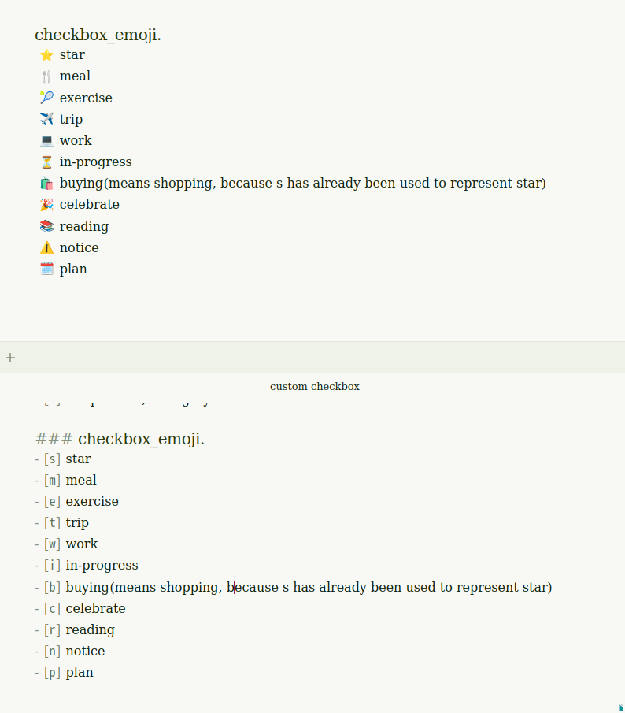
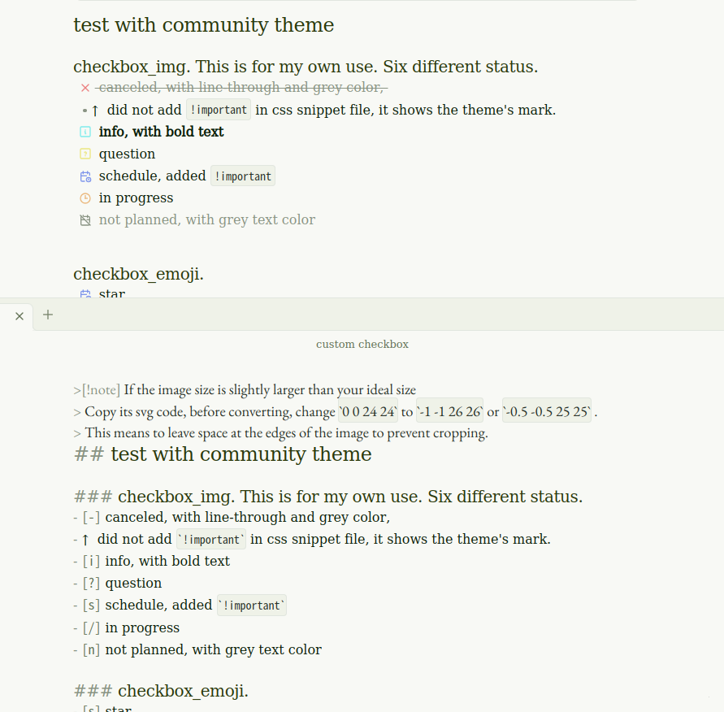
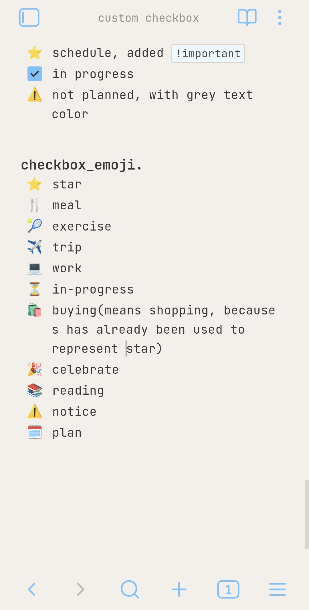
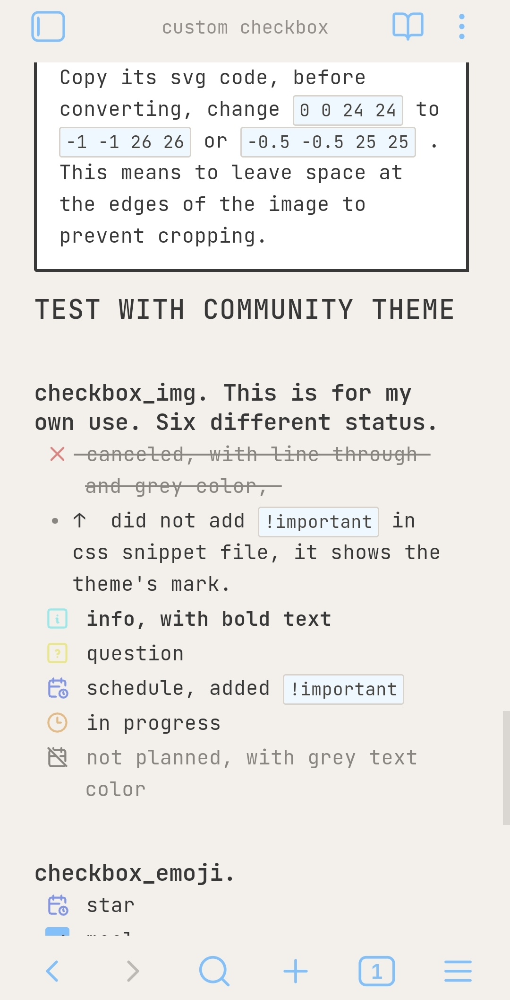

# Better checkboxes
This project is inspired by [Obsidian-Things](https://github.com/colineckert/obsidian-things) and [PLN](https://github.com/PipeItToDevNull/PLN) .
If your current theme do not provide many style of checkbox or you just want to use a richer or finer checkbox. I only set  few status for my own usage. You can customize it for your needs.

## How to use:
- PC
1. open your obsidian setting -> appearance -> css snippets -> open the folder
create a new file,
2. copy the code blocks in your file, and edit the code.
3. save, and done.
4. do not forget to turn it on to use it.

- Portable devices
1.  before move the file to your file system, please make sure that you can view **hidden files** on your device,
2. and move `checkboxes.css` to your target file.
3. It's the same steps as how to make it work on PC.
## How to customize
Code templates and guide are in file `custom.md`. Or you can edit those files directly.

>[!note] 
>Please note that there are symbol conflicts exist in those two files. Do not use two CSS snippets at the same time, or modify and ensure that there are no conflicts before use.

